# EDA Reference Writing Skill

面向 EDA 学术论文的参考文献写作与核查规范，提供可直接使用的 LaTeX 示例和 AI 编辑工作流程。

**正式论文精简，在线资源保留入口，必要软件注明版本。**

本仓库采用手写 `thebibliography` / `\bibitem`：统一作者、标题、出版信息、符号和引用键，并检查正文与 reference 的对应关系。

[安装与使用](#安装与使用) · [分类速查](#分类速查) · [分类示例](#分类示例) · [作者规则](#作者规则) · [符号与标点](#符号与标点) · [引用键](#引用键) · [编译与核查](#编译与核查) · [文档](#文档)

## 安装与使用

### 在 Codex 中使用

把本仓库安装到 `~/.codex/skills/eda-reference-style`。目标目录已存在时，先比较并合并已有修改。

```bash
git clone https://github.com/yuan-fd/EDA-Reference-writing-skill.git \
  ~/.codex/skills/eda-reference-style
```

在 Codex 中调用：

```text
使用 $eda-reference-style，核查当前论文的 reference。
先给出逐条修改建议；我确认后再修改。
```

也可以直接授权修改：

```text
使用 $eda-reference-style 修复 reference 格式，逐条修改，
同步正文和图中的引用键，保持现有版式，最后编译检查。
```

### 只使用格式规范

直接阅读下方示例即可，无需安装 Codex。各示例的 `.tex` 源文件位于 [examples/](examples/)，图像由对应 LaTeX 实际编译生成。

示例图用于展示引号、斜体、编号、页码和链接；论文最终字号、缩进及双栏排版由目标模板决定。示例中的年份、发表状态和 commit 是对应文献的记录，使用其他文献时须替换成自己的真实信息。

## 分类速查

| 类型 | 基本结构 | 链接 | 日期、页码与版本 |
|---|---|---|---|
| 正式会议论文 | 作者，标题，*Proc. 会议*，年份，页码 | 不显示 DOI / URL | 保留已确认的完整分页 |
| 缺少正式页码的会议论文 | 作者，标题，*Proc. 会议*，年份 | 不显示 DOI / URL | 省略页码，不用 PDF 总页数代替 |
| 已接收待发表 | 作者，标题，to appear in *Proc. 会议*，年份 | 不显示 DOI / URL | 不编造尚无的页码 |
| 期刊论文 | 作者，标题，*刊名* 卷(期) (年份)，页码 | 不显示 DOI / URL | 卷、期、年按固定结构排列 |
| arXiv 预印本 | 作者，标题，arXiv:编号，年份，URL | 保留一个 arXiv 入口 | 不把 arXiv DOI 当正式发表证明 |
| 实验基础软件 | 机构，项目名，commit hash，URL | 保留仓库入口 | 写实际实验版本 |
| 专用项目仓库 | 机构，项目名，URL | 保留仓库入口 | 复现需要时再补版本 |
| 官方公告 | 机构，标题，资源类型，发布日期，URL | 保留官方入口 | 保留发布日期，不写访问日期 |
| 书籍 | 作者，*书名*，城市，出版社，年份 | 通常不附链接 | 使用真实版本信息 |

## 分类示例

以下代码是可放进 `thebibliography` 的条目；完整环境见[编译与核查](#编译与核查)。

### 1. 正式会议论文

**LaTeX**

```latex
\bibitem{Kahng18}
A. B. Kahng,
``New Directions for Learning-Based IC Design Tools and Methodologies'',
{\em Proc. ASP-DAC}, 2018, pp. 405--410.
```

**显示效果**

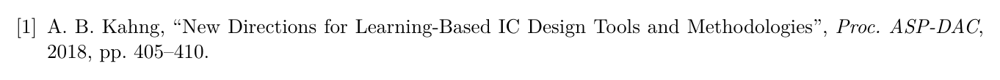

**讲解**

- 按“作者 → 标题 → 会议 → 年份 → 页码”排列。标题用双引号，会议名称用斜体。
- 会议采用一致的简称，例如 `Proc. DAC`、`Proc. ICCAD`、`Proc. ASP-DAC`。
- `405--410` 编译为完整页码范围 405–410。正式论文不再重复附 DOI 或 URL。

### 2. 尚未查到正式页码的会议论文

**LaTeX**

```latex
\bibitem{KahngKP26b}
A. B. Kahng, S. Kundu and B. Pramanik,
``HELIX: Placement Heuristics Evolution via LLM-Instructed Code Exploration'',
{\em Proc. ICCAD}, 2026.
```

**显示效果**

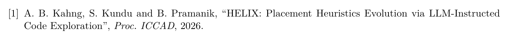

**讲解**

- 能确认论文和会议，但查不到正式分页时，在年份后结束条目。
- 不把 PDF 有九页写成 `9 pages`，也不据此推导 `pp. 1--9`。
- 如果正式出版记录本身给出 `pp. 1--9`，则可以使用；关键在于分页依据，而不是数字是否从 1 开始。

### 3. 已接收、待发表的论文

**LaTeX**

```latex
\bibitem{RenCHSJTFWYH27}
S. Ren, Z. Cheng, Y. Han, L. Shen, L. Jin et al.,
``AgenticPD: A Stage-Aware Agentic Framework for Closed-Loop Physical Design Optimization'',
to appear in {\em Proc. ASP-DAC}, 2027.
```

**显示效果**

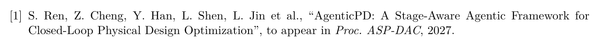

**讲解**

- 用 `to appear in` 标明已接收待发表，并保留目标会议年份。
- 仅上传 arXiv 不能使用此写法，必须有录用或正式出版依据。
- 待发表与预印本分开处理；已有正式出版信息后，再更新相应字段。

### 4. 期刊论文

**LaTeX**

```latex
\bibitem{SaurabhSS19}
S. Saurabh, H. Shah and S. Singh,
``Timing Closure Problem: Review of Challenges at Advanced Process Nodes and Solutions'',
{\em IETE Tech. Rev.} 36(6) (2019), pp. 580--593.
```

**显示效果**

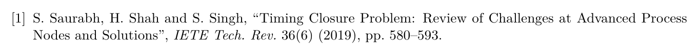

**讲解**

- 保留论文标题，刊名使用斜体。
- 固定结构为 `Journal volume(issue) (year), pp. start--end`。例如 `36(6) (2019)`。
- 刊名与卷号有空格，卷号与期号括号之间无空格，期号与年份括号之间有空格。
- 不在同一列表中混用另一套 `vol. ..., no. ...` 写法；不附 DOI / URL。

### 5. 使用文章关联分页的期刊论文

**LaTeX**

```latex
\bibitem{ShiftLeftSurvey26}
X. Wu, Z. Li, F. Hu, T. Lin, R. Wang et al.,
``Shift-Left Techniques in Electronic Design Automation: A Survey'',
{\em ACM Comput. Surv.} 58(13) (2026), pp. 348:1--348:35.
```

**显示效果**

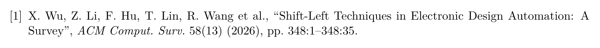

**讲解**

- `348:1--348:35` 是带文章标识的页码范围，保留完整形式。
- 不要缩成 `348`，也不要丢掉前缀改成普通 `1--35`。
- 若出版商只提供电子文章号，则保留真实定位符，不根据 PDF 长度补出普通页码。此处的语义引用键是保留既有键的例子。

### 6. arXiv 预印本

**LaTeX**

```latex
\bibitem{ChenSLSZ26}
Z. Chen, Z. Song, Y. Li, Q. Sun and C. Zhuo,
``FluxEDA: A Unified Execution Infrastructure for Stateful Agentic EDA'',
arXiv:2603.25243, 2026,
\url{https://arxiv.org/abs/2603.25243}.
```

**显示效果**

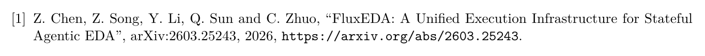

**讲解**

- 同时保留 arXiv 编号、年份和一个摘要页入口：编号用于识别，链接便于访问。
- 使用 `\url{...}`，让 LaTeX 正确处理链接及换行。
- 不重复列出 arXiv URL、PDF 下载链接和 arXiv DOI；优先摘要页 `abs`。
- 确认同一工作正式发表后，可换成会议或期刊条目，不再把两个版本重复列出。

### 7. 注明实验版本的软件仓库

**LaTeX**

```latex
\bibitem{OpenROADProjectRepo}
The OpenROAD Project,
``OpenROAD'', commit hash: \texttt{08f67ee5},
\url{https://github.com/The-OpenROAD-Project/OpenROAD}.
```

**显示效果**

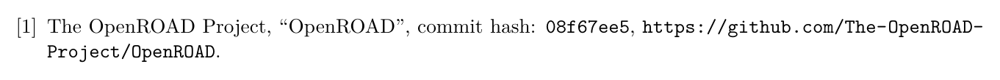

**讲解**

- OpenROAD、ORFS 等持续演进且影响实验结果的依赖，注明实际使用的 commit 或 tag。
- `\texttt{08f67ee5}` 以等宽字体显示 SHA；这个 SHA 仅是本示例的实验版本。
- 不能用 GitHub 当前最新提交替代实际实验版本。正文不同实验若使用不同版本，应分别说明。
- 保留仓库入口，不为凑齐字段添加虚构年份、`n.d.` 或访问日期。

### 8. 专用项目仓库

**LaTeX**

```latex
\bibitem{ChipEvolveRepo}
CODA-Team,
``ChipEvolve'',
\url{https://github.com/CODA-Team/ChipEvolve}.
```

**显示效果**

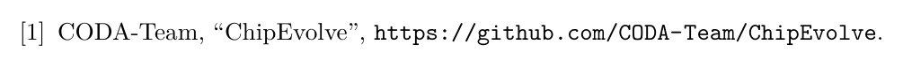

**讲解**

- 对于给出项目入口即可识别的专用项目，机构、项目名和 URL 就可以组成条目。
- 是否需要 commit 取决于引用目的及复现需要，不能因为是软件就机械要求同一组字段。
- 仓库入口与论文是不同对象；需要引用论文时，应使用对应论文条目。

### 9. 官方网页与模型公告

**LaTeX**

```latex
\bibitem{OpenAI26}
OpenAI,
``Introducing GPT-5.3-Codex'', official model announcement,
February 5, 2026,
\url{https://openai.com/index/introducing-gpt-5-3-codex/}.
```

**显示效果**

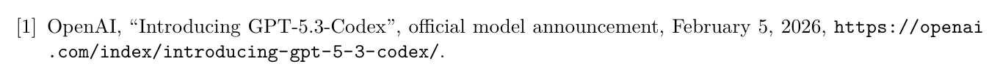

**讲解**

- 使用机构作者、官方标题、资源类型、实际发布日期和官方 URL。
- `February 5, 2026` 是发布日期，应保留；`accessed ...` 是访问日期，此风格不添加。
- 引用具体模型时保持真实名称与版本，不自动替换为最新模型。

### 10. 书籍

**LaTeX**

```latex
\bibitem{CormenLRS09}
T. H. Cormen, C. E. Leiserson, R. L. Rivest and C. Stein,
{\em Introduction to Algorithms}, Cambridge, MA, MIT Press, 2009.
```

**显示效果**

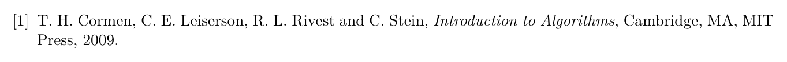

**讲解**

- 书名使用斜体，不放在论文标题式双引号中。
- 按“作者 → 书名 → 城市 → 出版社 → 年份”排列。
- 引用的版次必须与所使用的书一致。本例对应 2009 年第三版；存在多个版本时可进一步注明版次。

## 作者规则

### 姓名、顺序与截断

- 姓名使用“名字首字母 + 完整姓氏”，如 `A. B. Kahng`。
- 尊重真实作者顺序，保留连字符、复姓和重音。
- **五人及以下全部列出**，最后两名作者用 `and` 连接，`and` 前不加逗号。
- **超过五人只列前五人**，后接普通字体的 `et al.`，不加 `and`。
- 机构作者整体保留，如 `The OpenROAD Project`，不拆成人名。

### 超过五人的实际例子

**LaTeX**

```latex
M. Liu, T.-D. Ene, R. Kirby, C. Cheng, N. Pinckney et al.,
```

**显示效果**

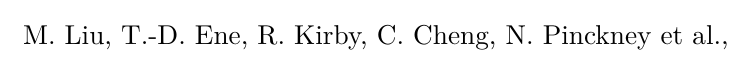

**讲解**

这里保留 ChipNeMo 的前五名作者。姓名首字母中的句点要保留；`et al.` 的句点也要保留。条目末尾的句号规则不意味着删除缩写中的句点。

### 最后两名作者的连接方式

| LaTeX | 显示效果 | 说明 |
|---|---|---|
| `A. One and B. Two,` | A. One and B. Two, | 两人不用逗号分开 |
| `A. One, B. Two and C. Three,` | A. One, B. Two and C. Three, | 最后一对用 and，前面不加逗号 |
| `A. One, B. Two, C. Three, D. Four and E. Five,` | A. One, B. Two, C. Three, D. Four and E. Five, | 五人全列 |

`One` 至 `Five` 是说明结构的占位姓名，实际文献必须使用真实作者。

## 符号与标点

### 常用 LaTeX 写法

| LaTeX | 显示效果 | 用途 |
|---|---|---|
| <code>``Title''</code> | “Title” | 成对的论文标题引号 |
| <code>``Title'',</code> | “Title”, | 结束引号后接字段逗号 |
| `pp. 123--131` | pp. 123–131 | 完整页码范围 |
| `{\em Proc. DAC}` | *Proc. DAC* | 会议名斜体 |
| `{\em Nature} 594(7862) (2021)` | *Nature* 594(7862) (2021) | 刊名、卷期和年份 |
| `P\&R` | P&R | 正文/标题中的 & |
| `20\%` | 20% | 百分号 |
| `\texttt{trial\_A}` | `trial_A` | 普通文本中的下划线 |
| `\#1` | #1 | 井号 |
| `\{x\}` | {x} | 显示花括号；普通 `{...}` 仅用于分组 |
| `\textbackslash{}` | \ | 显示反斜杠 |
| `\textasciitilde{}` | ~ | 显示字面波浪号；普通 `~` 是不换行空格 |
| `\textasciicircum{}` | ^ | 显示字面脱字符，不进入数学上标 |
| `-` / `--` / `---` | - / – / — | 连字符 / 范围横线 / 长破折号 |
| `\$5` | $5 | 美元符号 |
| `N. V\~u` | N. Vũ | 人名重音 |
| `\url{https://example.org/a_b}` | https://example.org/a_b | URL 内直接保留下划线，不再写成 `\_` |
| `Kahng~\cite{Kahng18}` | Kahng [1] | 人名与引用间的不换行空格 |

**组合 LaTeX**

```latex
``P\&R: 20\% Improvement'', pp. 123--131, N. V\~u,
\texttt{trial\_A}, \#1, \$5.
```

**显示效果**

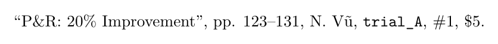

**讲解**

未转义的 `%` 会把后面内容当作注释；未转义的 `&` 在普通文本中会触发对齐错误；普通文本的 `_` 也不能直接照搬 URL 中的写法。标题保持正常字体，会议/期刊名或书名使用斜体，SHA 可用等宽字体。

### 标点与空格

- 作者、标题、出版信息等字段以逗号分隔，整条以一个句末句号结束。
- 保留 `A. B.`、`Proc.`、`pp.`、`et al.` 中的缩写句点。
- 标点后留正常空格；刊名与卷号之间也留空格。
- 页码写完整，不把 `123--131` 缩成 `123--31`。
- URL 的句末句号写在 `\url{...}` 外，避免它成为链接的一部分。

## 引用键

### 人名文献的命名

使用：

```text
首作者完整姓氏 + 其他作者姓氏首字母 + 两位年份
```

| 文献作者 | 引用键 | 说明 |
|---|---|---|
| A. B. Kahng，2018 | `Kahng18` | 单作者 |
| S. Saurabh、H. Shah、S. Singh，2019 | `SaurabhSS19` | 其他作者姓氏为 Shah、Singh |
| Z. Chen、Z. Song、Y. Li、Q. Sun、C. Zhuo，2026 | `ChenSLSZ26` | 保持实际作者顺序 |
| 相同作者键与年份发生冲突 | `KahngKP26a`、`KahngKP26b` | 加后缀区分不同工作 |

**展示作者只列前五名，不意味着新建引用键也只取前五名。** 引用键与可见条目是不同层次。已有合法且稳定的键不必只为缩短而批量重命名；机构资源可使用 `OpenROADProjectRepo` 等语义键。

### 从正文引用到条目

**LaTeX**

```latex
Kahng~\cite{Kahng18} discusses learning-based IC design tools.

\begin{thebibliography}{99}
\bibitem{Kahng18}
A. B. Kahng,
``New Directions for Learning-Based IC Design Tools and Methodologies'',
{\em Proc. ASP-DAC}, 2018, pp. 405--410.
\end{thebibliography}
```

**显示效果**

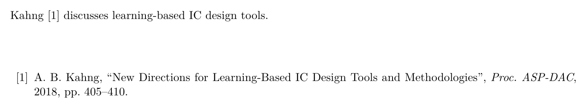

**讲解**

`Kahng18` 是连接正文与条目的标识，不会显示给读者；读者看到的是编译生成的 `[1]`。参考文献增加或移动后，由 LaTeX 更新编号，不在正文硬写 `[1]`。

修改键时，应一起更新正文、图、表、caption、TikZ 和其他参与编译的文件。只改 `\bibitem` 而保留旧 `\cite`，会产生缺失引用。

### 引用位置

- Related Work：引用紧跟所介绍的工作名称或作者名称。
- 其他章节：一般放在相关句末；明确介绍具体工作时，也可紧跟其名称。
- 不用孤立的 `[12] introduce ...` 作句子主语，明确写出作者或所指工作。
- 每个列出的条目都应在论文中主动引用；仅写 `\nocite{*}` 不能替代正文介绍。

## 编译与核查

### 最小可编译文档

```latex
\documentclass{article}
\usepackage[hyphens]{url}
\usepackage[hidelinks]{hyperref}
\usepackage{xurl}

\begin{document}

Kahng~\cite{Kahng18} discusses learning-based IC design tools.

\begin{thebibliography}{99}
\bibitem{Kahng18}
A. B. Kahng,
``New Directions for Learning-Based IC Design Tools and Methodologies'',
{\em Proc. ASP-DAC}, 2018, pp. 405--410.
\end{thebibliography}

\end{document}
```

`{99}` 用来预留两位数标签宽度，不表示有 99 条文献。参考文献保存在论文项目内，避免依赖个人机器外部文件；不再另启一套 BibTeX 输出。

在实际论文中保留原模板，按需添加未提供的宏包。存在 `hyperref` 等宏包时不要重复加载或引入冲突选项。

### 重新编译本仓库示例

使用 [Tectonic](https://tectonic-typesetting.github.io/)：

```bash
cd examples
tectonic reference-examples.tex
tectonic citation-keys-document.tex
```

也可以使用正常的 LaTeX 工具链；正文引用需完成必要的二次编译。源码见 [reference-examples.tex](examples/reference-examples.tex) 与 [citation-keys-document.tex](examples/citation-keys-document.tex)；也可以直接查看[分类示例 PDF](examples/reference-examples.pdf) 和[正文引用 PDF](examples/citation-keys-document.pdf)。

### 修改顺序

1. 确认当前主文件实际输入了哪份 reference。
2. 先统一格式，再处理重复，最后核实出版信息与链接。
3. 一条一条修改，改前比较最新内容，保留其他作者的新编辑。
4. 同步正文和图表中的引用键。
5. 编译并查看 reference 页面和受影响的正文页面。

### 验收要点

- 活动源码中没有缺失条目、重复引用键或残留旧键。
- 每条文献都有主动引用，图中引用也计入。
- 没有用猜测年份、页码或最新 HEAD 填补未知信息。
- 正式论文、预印本、仓库及 artifact 的引用对象没有混淆。
- PDF 中没有 `[?]`、重叠、超栏、丢字或错误链接目标。
- 格式、元数据、引用闭合、编译和目视结果分别得到核查。

## 文档

| 文档 | 内容 |
|---|---|
| [Skill 入口](SKILL.md) | AI 的任务边界与执行规则 |
| [完整格式规则](references/format-rules.md) | 各类型条目、例外及详细要求 |
| [依据与来源](docs/style-basis.md) | writing_rule、老师定稿与 Kahng 论文实例的适用顺序和可追溯依据 |
| [工作流程](references/workflow.md) | 增量编辑、正文同步、去重及验收 |
| [常见问题与经验](references/lessons.md) | 试错教训和容易误判的情况 |
| [LaTeX 示例](examples/) | README 对应的可编译源文件 |

## 许可

仓库原创规范说明与工具指令采用 [MIT License](LICENSE)。参考文献中的论文、产品名称和所链接的第三方内容属于各自权利人。
